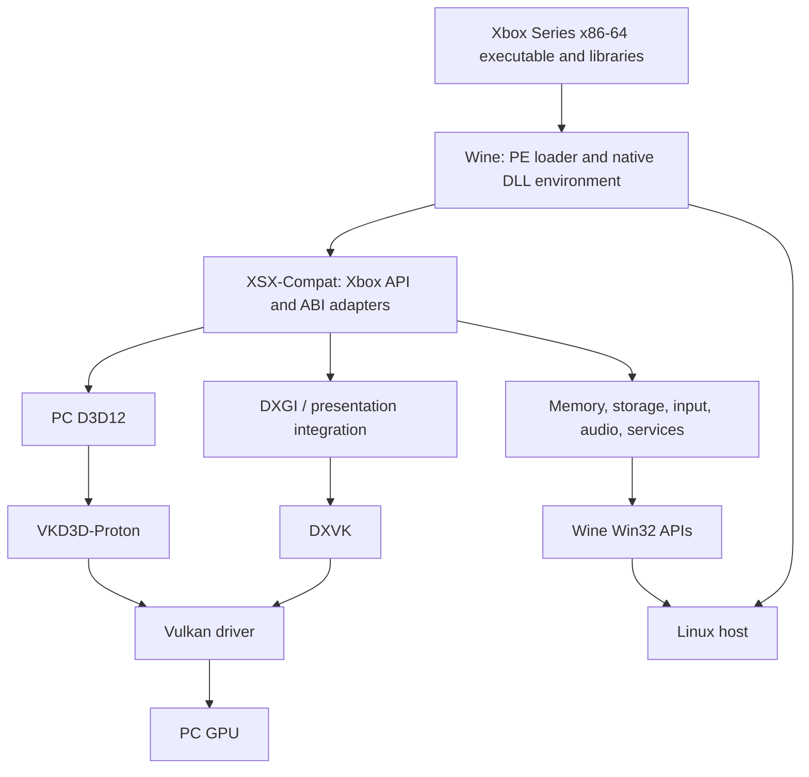

# XSX-Compat

Compatibility layer for launch Xbox Series games on Linux PC

XSX-Compat is an experimental compatibility layer for running native Xbox Series X|S software on an x86-64 Linux PC. It combines Wine, a custom Xbox API/ABI adaptation layer, and a Vulkan graphics stack built around VKD3D-Proton and DXVK.

The project started with small runtime and graphics experiments, then progressed through native Xbox FidelityFX initialization, shader-container research, and the startup of a real game executable. The current main research target is **GTA VI**, using the Xbox Series executable `game_scarlett_master.exe`.

**Current milestone: early game initialization and an instrumented graphics submission loop. A rendered GTA VI frame, working menu, and playable gameplay have not been demonstrated.**

**Status snapshot: November 24, 2026.** Development is active; individual experiments and shared development builds can differ from the frozen builds used for the results below.

## Contents

- [Project goals](#project-goals)
- [Current status at a glance](#current-status-at-a-glance)
- [How it works](#how-it-works)
- [Development history](#development-history)
- [GTA VI: the current startup stage](#gta-vi-the-current-startup-stage)
- [Technical implementation](#technical-implementation)
- [Native shader research](#native-shader-research)
- [FidelityFX and the fallback upscaler](#fidelityfx-and-the-fallback-upscaler)
- [Verified results](#verified-results)
- [Source layout](#source-layout)
- [Development environment](#development-environment)
- [Building and running the probes](#building-and-running-the-probes)
- [Running the game research setup](#running-the-game-research-setup)
- [Diagnostics and research workflow](#diagnostics-and-research-workflow)
- [Known limitations](#known-limitations)
- [Roadmap](#roadmap)
- [Contributing](#contributing)
- [External components and licensing](#external-components-and-licensing)

## Project goals

The long-term goal is to execute Xbox Series games on Linux by adapting the platform interfaces expected by their original binaries.

The main areas of work are:

- Xbox user-mode APIs, runtime services, and binary calling conventions.
- Xbox D3D12 interfaces, object lifetimes, command submission, and synchronization.
- Native shader containers, shader ABI, instruction translation, and pipeline states.
- Console memory allocation, resource placement, descriptor storage, and texture layouts.
- File access and DirectStorage-style streaming.
- Input, audio, networking, user services, and persistent game data.
- Presentation, correctness, stability, and eventually gameplay.

GTA VI provides a demanding concrete target, while smaller standalone probes make each compatibility problem reproducible. Reusable implementations and game-specific bootstrap workarounds currently coexist. Broader game compatibility is a future milestone, rather than an existing compatibility guarantee.

## Current status at a glance

| Area | Current result | Important remaining work |
|---|---|---|
| Native executable startup | The target executable loads and executes substantial initialization code under Wine | Reliable startup through every required subsystem |
| Imports and runtime | Import auditing, native CRT dependencies, GameRuntime initialization, and configuration handling have been exercised | Complete behavior of the imported services |
| Xbox D3D12 ABI | Device, queue, list, allocator, heap, and fence adaptations; real PC D3D12 work passes GPU probes | Remaining Xbox contracts and general interface coverage |
| GPU bootstrap | **62 checks passed, 0 failed** in a frozen standalone build | End-to-end integration with the complete game renderer |
| Native game shaders | Two selected programs translated and executed through real PC PSOs | General ISA coverage, pixel/mesh shaders, resource ABI, and game PSO integration |
| Shader-container analysis | **26,503 containers validated**, containing **26,698 native variants** in the scanned shader archive | Complete archive enumeration and broader translation |
| Diagnostic game rendering path | Thousands of valid synthetic PSOs, recorded draws, submissions, and repeated PresentX attempts appear in game logs | Actual game shaders, resource contents, and native presentation |
| GPU memory | Resource creation and allocation queries work for selected cases | Shared guest/GPU mappings, physical-page aliasing, and correct placed resources |
| Texture layout | Linear layout/copy prototype | Xbox swizzle, complete layout ABI, and correct texture contents |
| Storage | File/memory requests, zlib decompression, queue/status/error handling | BCpack, GPU/physical destinations, and full streaming semantics |
| Input | GameInput object and no-device initialization path | Actual controller, keyboard, mouse, and callback delivery |
| Audio | APU memory/address translation and observed SHAPE context allocation | SHAPE command channel, DSP/codec processing, and sound output |
| Networking | Original HTTP libraries pass **139 loopback checks**, with cleanup | Game integration, remote transport, authentication, and online services |
| Presentation | Xbox PresentX calls are observed and counted | A working native swapchain/presentation bridge |
| GTA VI gameplay | **Not demonstrated** | First correct game frame, menu, input/audio, and sustained execution |

These are subsystem results with different scopes. They should not be added together into a game compatibility percentage.

## How it works

Xbox Series games already contain x86-64 CPU code. XSX-Compat focuses on the operating-system interfaces, ABI differences, graphics contracts, and GPU programs around that code.

Wine provides the PE loading and Win32 environment. Custom DLLs supply or adapt Xbox-specific interfaces. Graphics calls reach PC D3D12 through VKD3D-Proton, with DXVK supplying the DXGI component used by the development graphics stack. Vulkan and the Linux graphics driver execute the resulting GPU work.



The diagram describes the intended architecture. The game's Xbox presentation bridge and several service backends are still incomplete.

The current execution model is a user-mode compatibility environment. Early GameOS/XVD and XVC experiments helped characterize the platform, but the working development path uses Wine and API adaptation rather than booting the console operating system.

### Why ordinary PC D3D12 forwarding is insufficient

Xbox and PC interfaces can share familiar names while using different virtual-table layouts, argument conventions, return conventions, and resource semantics.

Examples established during development include:

- Xbox device slot 76 creates a committed resource; forwarding that slot unchanged reaches a different PC method.
- A descriptor-heap getter returns a handle in a register on the observed Xbox path, while the PC implementation writes through an output pointer.
- Xbox queue slot 16 signals a fence; the PC method at that position writes a timestamp frequency.
- Xbox command-list slots 47 and 48 bind index and vertex buffers; the corresponding PC slots clear depth and color views.
- Xbox code accesses command-list fields directly to choose between inline packet generation and virtual calls.

The compatibility layer therefore needs explicit contracts and object wrappers, not just exported function names.

## Development history

### 1. Establishing the host runtime

The first experiments checked that small x86-64 PE programs, GameRuntime entry points, task queues, and ordinary D3D12 workloads could execute through Wine. Independent graphics tests created devices, buffers, command lists, queues, and fences, and checked GPU compute results through readback.

The workspace also gained exploratory package/container tests and a separation between locally supplied platform files, project-authored shims, and test programs.

This established the host foundation: Linux could execute the CPU code and submit PC graphics work. Xbox-specific interfaces still required adaptation.

### 2. Using native Xbox FidelityFX as a graphics test case

The next target was the original Xbox FidelityFX loader/upscaler, with provider enumeration and a reproducible `ffxCreateContext` test.

The first major success was adapting the Xbox committed-resource call and creating a real PC resource through VKD3D-Proton. The first observed texture was 1280 × 720, using an RGBA16F format and Xbox resource flags that required normalization for the PC API.

Initialization then crashed immediately after resource creation. Disassembly, interface identity checks, and runtime tracing showed that the faulting object was a descriptor heap. Its handle-return ABI differed from the PC implementation.

### 3. Preserving native resource identity

An early diagnostic resource proxy exposed another constraint: VKD3D validates the identities of its native resource objects. Replacing a resource's virtual table, or allowing a foreign proxy to enter an internal resource path, triggered assertions.

The working path retained the original native resource identity and adapted the relevant calls around it. This allowed SRV and UAV creation to proceed.

An Xbox texture layout value, `0x101`, then reached a PC unsupported-layout path. An experimental layout conversion moved initialization further.

The recorded native FidelityFX run eventually created **27 resources, 5 descriptor heaps, 27 SRVs, and 64 UAVs**, and created/reflected a real root signature. The next boundary was a native shader/pipeline-state operation.

### 4. Discovering the native shader boundary

The Xbox `FSR2-LUM_PYRAMID` pipeline did not contain ordinary PC shader bytecode in the form expected by the PC method it reached. The native call also occupied a different device slot.

Research expanded into FXCP, ACCC/FSPX, shader metadata, root bindings, embedded program hashes, and native RDNA instructions. This produced bounded parsers, corruption tests, ISA inspection tools, and an increasingly precise description of the shader ABI.

The original FidelityFX context remained blocked at native PSO creation. That result is retained as a separate regression boundary.

### 5. Moving from a library test to a game executable

The project adopted `game_scarlett_master.exe` as its concrete game target. The first available input was an executable report, which identified a PE32+ AMD64 program with **68 import descriptors and 587 imported symbols**, including **47 API-set contracts**.

An import probe exposed missing Xbox exports and dependencies. The runtime environment then gained the required bootstrap shims, native CRT dependencies, GameRuntime configuration, and isolated game deployment.

Once the executable and content were available locally, work progressed from static import analysis to the real game's initialization, archive access, memory pools, input setup, and graphics-device creation.

### 6. Bringing up game services and data access

The project added XMem allocation and mapping compatibility, a no-device GameInput object, and a DirectStorage-style implementation exported as `XCRDAPI.dll`.

The game opened the observed set of RPF archives and progressed through its own archive mounting, decompression, and initialization paths. Missing or incomplete local content had to be distinguished from ABI failures.

In parallel, APU memory handling gained a tested address-space model, and the original HTTP libraries were exercised against a local server. These became independent regression probes rather than relying on the entire game to validate each service.

### 7. Reconstructing the renderer's ABI

The graphics adapter expanded from the initial resource experiment into device and child-object wrappers. Several concrete failures were resolved:

| Failure | Cause established by investigation | Resulting change |
|---|---|---|
| Wrong queue operation | A PC queue method was forwarded through an incorrect slot | Correct ExecuteCommandLists forwarding and list unwrapping |
| Query-heap assertion | Xbox list52 received ordinary data, not a PC query heap | Separate Xbox and PC contracts; preserve real PC query behavior |
| PSO AddRef into code bytes | A generic successful return left an output pointer uninitialized | Initialize outputs and return explicit failure outside diagnostic mode |
| Invalid depth allocation size | Xbox flags produced an illegal PC depth/UAV combination | Consistent, narrowly scoped depth-backing normalization |
| Wrapper allocation AV | Concurrent cursor/commit updates crossed an uncommitted arena boundary | Synchronized, checked wrapper allocation |
| Fence virtual table overwritten | Xbox Signal was sent to PC GetTimestampFrequency | Typed fence/queue dispatch and real completion tracking |
| Root-parameter failures | Root signatures, descriptor tables, and constants reached incompatible PC slots | Explicit root-binding adapters |
| Write through a null packet cursor | A host-side tag overlapped the Xbox command-buffer limit | External metadata and correctly separated inline list storage |
| Clear-view AV during vertex setup | Xbox index/vertex bindings reached PC clear methods | Separate IA47/48 and PC clear47/48 paths |

The graphics probe grew from **29 passing checks to 62** as these failures became reproducible regression cases.

### 8. Executing selected translated game shaders

Offline analysis found and validated thousands of native shader containers in `shaders.rpf`. A limited instruction translator then produced HLSL/DXIL for two selected native programs: a fullscreen vertex shader and a compute shader that initializes indirect arguments.

Both programs executed through real PC pipeline states and passed GPU readback checks. This proved a small translation path from game shader instructions to actual GPU results.

### 9. Switching to a focused bootstrap path

The current strategy concentrates on the chain needed to reach a frame:

```text
PSO → SetPipelineState → resources/barriers → Draw or Dispatch
    → ExecuteCommandLists → PresentX → native presentation
```

Unknown calls are collected into a common slot/caller registry. They are investigated when they block that chain, rather than implementing every logged slot immediately.

An explicit diagnostic mode supplies valid synthetic graphics/compute PSOs. It lets the game progress through command recording and submission while native game-shader translation remains under development.

## GTA VI: the current startup stage

The current result is **real game startup reaching renderer activity**, with important operations still implemented as bootstrap fallbacks.

| Startup stage | Observed behavior | Scope |
|---|---|---|
| PE loading | The executable and dependencies load sufficiently to execute game initialization | Working startup path; not a complete replacement for all platform services |
| Runtime initialization | GameRuntime and game configuration handling are reached | PC runtime integration plus Xbox adaptations |
| Memory setup | Console virtual-memory setup, XMem allocations, and large pools are reached | CPU-backed approximation of console memory semantics |
| Input setup | GameInput creation and callback registration are reached | No actual input devices are supplied by the current shim |
| Data access | RPF9 archives are opened; archive and streaming initialization proceeds | File/data completeness and unsupported request types remain relevant |
| Graphics setup | Device creation, root signatures, resource allocations, queues, and lists are reached | Adapted PC backing objects and partial Xbox contracts |
| PSO/bootstrap rendering | Diagnostic builds create synthetic PSOs and record draws/submissions | Original game shaders are not executed by these synthetic PSOs |
| Presentation request | The game repeatedly calls PresentX | Native presentation remains unimplemented in the documented path |
| Game frame/menu | Crash reports still record **Game Init / Frame 0** | No verified rendered game frame or menu |
| Gameplay | Not demonstrated | Future milestone |

One recorded diagnostic game run reported:

```text
BOOTSTRAP PresentX attempt=8 planes=1 pso=10241 set=22 barriers=0 draw=22 dispatch=0 execute=8 native_present=0 noop=1
```

This is evidence of substantial initialization and repeated graphics-path activity. The counters describe that particular instrumented run. They do not measure rendering correctness, and they do not imply that every stage was exercised: for example, that excerpt records no Dispatch calls.

`native_present=0` explicitly means that a PresentX request was counted without a native displayed-frame implementation. A window surviving longer, repeated PresentX calls, or a successful synthetic GPU workload is not treated as a rendered GTA VI frame.

The game still terminates during initialization in the documented runs. Different development checkpoints have exited with codes 3 or 5. Remaining graphics, memory, storage, and audio gaps mean that a single permanent final blocker has not yet been established.

## Technical implementation

### D3D12 device and COM adaptation

The principal adapter is `compat/d3d12_xs/d3d12_xs.cpp`, built as `d3d12_xs.dll`.

Its responsibilities include:

- Exporting the Xbox device-creation, virtual-memory configuration, and root-signature entry points required by the current target.
- Creating real PC D3D12 devices through the existing graphics stack.
- Providing extended wrapper tables for the observed Xbox interfaces.
- Adapting differing method slots and aggregate-return calling conventions.
- Unwrapping wrapped child objects before forwarding them into native PC calls.
- Tracking the observed Xbox command-list dialect separately from PC-created lists.
- Initializing outputs and preserving COM reference ownership.
- Logging unresolved contracts with module-relative caller addresses.

The current tables are based on the interfaces and binaries observed during this research. They are not a universal specification for every Xbox GDK version.

### Resources, heaps, and descriptors

The resource path creates actual PC D3D12 resources and preserves their native identities. The same resource-description normalization is used for selected allocation queries and creation paths, so sizing and backing-resource decisions remain consistent.

Implemented adaptations include selected Xbox flag removal, an experimental layout conversion, CPU descriptor-handle translation for guest-provided heap ranges, and a narrowly scoped depth-only fallback for an observed Xbox depth/UAV allocation.

Important limits remain:

- The depth fallback does not implement a synchronized UAV shadow of the depth surface.
- A committed-resource fallback does not make the resource share the game's original CPU/GPU memory.
- Xbox raw descriptors written directly into guest memory are not fully translated into PC descriptors.
- The game's virtual buffer addresses are not generally registered as valid native GPU buffer addresses.
- Heap creation and successful allocation queries do not establish correct resource contents.

### Command recording and synchronization

Queue submission unwraps the list array and calls the real PC ExecuteCommandLists method. GPU tests exercise both the PC submission path and Xbox ExecuteCommandListsX adaptation.

Fence adaptation provides a pollable completion address for the observed Xbox API. A worker mirrors the real native fence completion value, and removes a registration before its final release. GPU Signal/Wait and completion tests verify that the mirror reflects completed work.

Command-list storage also needs to accommodate direct game writes. Observed inline fields extend well beyond the small host wrapper header. Lists therefore reserve a separate storage area, while host ABI tags are kept outside fields used as Xbox packet cursors or limits.

Several Xbox-specific recording and reset operations remain unresolved. Current wrappers cover the tested paths, rather than the full command-list API.

### Diagnostic no-op PSO mode

`XSX_DEV_NOOP_PSO=1` enables an explicitly synthetic graphics bootstrap.

In this mode:

- The observed native graphics-PSO path returns a valid PC graphics PSO.
- Its vertex shader produces degenerate geometry outside the clip volume and does not require game resources.
- The native compute path can return a valid empty compute PSO.
- Pipeline-state updates retain a valid owned COM reference.
- Draw and Dispatch bind the appropriate synthetic pipeline and record real native commands.
- Guest root bindings covered by the diagnostic bypass are suppressed because the synthetic root layout is empty.
- Topology is normalized for the synthetic graphics workload only.
- Resource barriers and submissions continue through native PC APIs.
- PresentX reports aggregate counters and explicitly records `native_present=0`.

This mode has passed a standalone GPU test covering PSO creation, reference handling, Draw, Dispatch, resource transition/copy, submission, native fence completion, and a 64-byte guard.

It is a tool for advancing startup and locating the next dependency. It does not translate the game's original shaders or reproduce its image.

### Xbox memory: XMem

`compat/runtime/xmem/` implements aligned allocation/free, virtual-memory operations, and the observed physical-page API surface.

The current backend uses ordinary CPU memory and Wine virtual-memory APIs. The physical-page compatibility path allocates page identifiers and commits corresponding virtual-address ranges, including scatter mapping. It does not implement true physical-page aliasing: mapping the same page identifier at two addresses is not yet equivalent to sharing one backing page.

Console allocation attributes, page policies, cache behavior, and CPU/GPU visibility still need a fuller model. Some exports remain unsupported or provisional.

### DirectStorage-style I/O

`compat/runtime/xcrdapi/` supplies `DStorageGetFactory` and the observed factory, file, queue, and status objects.

The implementation includes:

- File opening and offset-based file-to-memory reads.
- Memory-to-memory requests.
- Worker-backed request submission.
- zlib decompression.
- Status completion and error reporting.
- Cancellation-tag handling and fence-signal entries.

The game's factory/request ABI differs from the initially consulted wrapper sample, so the implementation uses layouts recovered from actual game calls.

BCpack, swizzled requests, and physical-page source/destination semantics remain unsupported. Real game streaming is only partially covered by the current backend.

### Texture layout: XG

`compat/runtime/xg/` provides a prototype `XGCreateTextureComputer`, linear subresource-layout calculations, and copy helpers. `XGSuggestSwizzleMode` remains a placeholder with an incomplete contract.

Correct Xbox tiling/swizzle, complete texture-description ABI coverage, and reliable content upload are still required. The linear prototype is a bootstrap component, not proof of correctly displayed game textures.

### GameInput

The GameInput shim creates the required object, supplies timestamps, accepts callback registrations, and reports a no-device/no-reading state.

Actual device enumeration, input sampling, callback delivery, and gameplay controls remain to be implemented.

### Audio and APU services

`compat/runtime/audio/` implements a CPU-backed APU memory model with a separate 32-bit APU address space, checked alignment/ranges, allocation/free validation, and CPU-to-APU/APU-to-CPU translation.

The observed game ABI differs from older reference signatures. In particular, the game's APU-address lookup takes a CPU pointer and returns a 32-bit address directly. The implementation follows the actual caller.

The observed SHAPE context array can also be allocated. However, `AcpHalCreate` still reports an unsupported command/message channel instead of returning a false success with a null object.

SHAPE processing, DSP behavior, codec integration, audio scheduling, and output remain open work. `chad`/XDsp and `xapu` still have bootstrap stubs. Bink/XAudio integration is a separate path and has not established working game sound or video playback.

### Networking and runtime services

The network probe loads the original `libHttpClient.GDK.dll` and `XCurl.dll`, initializes the PC GameRuntime, and exercises them against a real local HTTP server.

A scoped XNetworking provider supplies the missing service needed by XCurl in that probe. It implements initial state notification, registration/unregistration, queued callback cancellation, and the narrow security-information path needed for plaintext numeric loopback HTTP.

The current result includes successful real HTTP requests, binary bodies, response/status validation, and cleanup. The provider is integrated into the test harness; full game integration and remote networking are separate tasks.

HTTPS verification, external endpoints, authentication, Xbox account/store/save services, and online gameplay are not established by the loopback result.

### Isolated game execution

The game research setup uses Bubblewrap and a dedicated Wine prefix. It exposes selected read-only system paths, project-controlled writable game/prefix/home directories, a GPU render node, and an optional Wayland socket.

The game-content directory is mounted read-only. The sandbox isolates network access and does not expose X11 or a host audio socket. A dedicated probe has reported `leaks=0` for the paths and interfaces it checks; this is a tested configuration result, not a general security certification.

Service probes use their own prefix and loopback networking. Their transport tests do not imply that the game sandbox has external network access.

## Native shader research

### Container discovery

The inspected `shaders.rpf` archive contains **26,503 discovered named shader records**, all of which passed the container checks used by the scanner. Those records contain **26,698 native variants**.

| Stage | Validated containers |
|---|---:|
| Vertex shader | 2,236 |
| Mesh shader | 9,282 |
| Pixel shader | 12,101 |
| Geometry shader | 195 |
| Compute shader | 2,689 |
| **Total** | **26,503** |

This is a validated scan of discovered records. Completeness against the archive's encrypted table of contents has not been established, and the result does not imply that all shaders are translated.

The observed game-container chain is:

```text
Named archive record
  → raw DEFLATE
    → DXBC container
      → DXIL chunk containing a NOBC placeholder and XDAT metadata
        → XBCH v3 compressed payload
          → FSSM v0x101
            → hardware descriptors and native RDNA instructions
```

A chunk named `DXIL` is therefore not sufficient evidence of usable PC LLVM bitcode. In these records, the native program lives deeper in the container.

The parsers validate sizes, bounds, overlaps, versions, decompression limits, signatures, and observed embedded hashes. Opaque trailers and unknown metadata fields are preserved without assigning them invented semantics.

### FidelityFX container research

Earlier work investigated **927 FXCP containers** from an Xbox FidelityFX library, including **8,806 resource bindings** checked against their root signatures. A separate game-library path examined **29 ACCC/FSPX records** and their bindings.

Instruction decoding, control-flow boundaries, root-binding provenance, and candidate wave/register information have been studied across these corpora. Successful disassembly is treated as decoding evidence, not proof of equivalent execution.

Unknown encodings, descriptor formats, control flow, and input-register conventions still limit general translation.

### The implemented translation path

The current offline tools translate a restricted set of recovered instruction semantics into HLSL, compile it with DXC into PC DXIL, and create ordinary PC D3D12 pipeline states for GPU validation.

```text
Native Xbox shader container
  → validated metadata and instruction stream
    → supported ISA semantics and explicit ABI assumptions
      → generated HLSL
        → DXC / PC DXIL
          → PC D3D12 PSO
            → VKD3D-Proton / Vulkan
              → GPU execution and readback
```

The translator rejects unsupported instructions or ABI patterns. It does not choose a substitute implementation from the shader's name or hash.

Two selected programs have executed successfully:

| Program | What was translated | GPU validation |
|---|---|---|
| Fullscreen-triangle VS | A 14-instruction native vertex program, including its exports | 8 × 8 RGBA32F output; 64 pixels / 256 components; zero failures and zero maximum error |
| Indirect-argument initialization CS | A 10-instruction native compute program with a raw-buffer store | 4 DWORDs written; 12 guard DWORDs preserved; zero failures; exit 0 |

The VS probe uses a synthetic pixel shader to expose its output for comparison. The compute probe validates an actual memory write, rather than just successful pipeline creation.

For the selected compute program, the validated PSV0 metadata supplies the raw UAV binding at `u8, space1` and a `(1,1,1)` thread-group size. The probe builds a matching PC root signature. Its constrained descriptor/user-data mapping is not yet a general Xbox root-ABI implementation.

General EXEC/VCC behavior, branches, LDS/barriers, atomics, texture operations, descriptor indexing, floating-point edge cases, mesh shaders, and complete user-data mappings remain open work. Some initial-register mappings are explicit program-specific ABI assumptions.

### Connecting runtime PSOs to the shader archive

Bounded runtime capture of the first eight native graphics-PSO descriptions produced **14 full 128-bit metadata-hash matches**, identifying **10 distinct programs** in the shader archive.

This connects runtime requests to specific vertex/pixel programs. It does not by itself decode the full pipeline state, relocations, root ABI, or shader allocation buffers. Zero-filled captured regions are retained as observations; their input/output/workspace roles are not assumed.

The remaining integration task is to turn a real runtime PSO request into a correctly bound PC pipeline, with shader translation, fixed state, resources, caching, and lifetime handled together.

## FidelityFX and the fallback upscaler

The project maintains two separate FidelityFX-related paths.

### Original Xbox FidelityFX

The native library test exercises the original Xbox loader/upscaler. Provider enumeration works for the recorded provider versions, and resource/descriptor/root-signature initialization has advanced significantly.

The last documented native context result remains:

```text
Native pass: FSR2-LUM_PYRAMID
Native PSO creation: E_NOTIMPL
ffxCreateContext: 0x8000000D
Harness-reported exit: 8
```

A successful native FidelityFX context, full FSR dispatch, and native FSR4 output have not been established by the current evidence.

### `ffx_min`

`compat/ffx_min/` supplies a small replacement for the loader-facing API used by the game bootstrap. It includes context lifecycle/query handling and a PC compute path for basic bilinear upscaling.

This is a fallback for development. It does not implement the full temporal, reconstruction, frame-generation, or machine-learning behavior of the original FidelityFX pipelines. A successful context call through `ffx_min` must be distinguished from success in the original Xbox FidelityFX test.

The game deployment script currently selects this replacement loader; the native-library probes retain their separate original-library fixtures.

## Verified results

The project uses separate tests for host parsing, ABI behavior, GPU correctness, service behavior, and actual game startup.

| Test or milestone | Recorded result | What it establishes |
|---|---|---|
| Basic host D3D12/compute probes | Device creation, submission, and compute readback passed | The underlying Wine/PC graphics stack can execute the test workloads |
| Native Xbox FidelityFX resource path | 27 resources, 5 heaps, 27 SRVs, 64 UAVs, root-signature creation/reflection | Initialization advanced to the native PSO boundary |
| Shader-container scan | 26,503 validated containers / 26,698 variants | The discovered records satisfy the implemented format checks |
| Shader frontend/translation tests | 20 newer tests plus 23 preceding tests passed in the recorded checkpoint | Bounds/corruption checks, selected instruction/ABI behavior, and compiler output validation |
| Translated native VS | 64 pixels / 256 components, failures 0, maximum error 0 | The selected translated vertex program produces the expected output in its standalone probe |
| Translated native CS | 4 DWORDs written / 12 guard DWORDs retained, failures 0, exit 0 | The selected translated compute program performs the expected GPU store |
| Graphics ABI regression | **62 passed / 0 failed** | The frozen probe covers adapted calls, real rendering/readback, synchronization, and synthetic bootstrap PSOs |
| Wrapper concurrency regression | 32,768 unique wrappers created across 8 threads | The tested concurrent allocation and reference-lifetime paths survive arena commit boundaries |
| APU host memory tests | 70 checks and 4,000 threaded allocations; live allocations 0 | CPU/APU allocation, mapping, bounds, and lifetime behavior under the tested conditions |
| APU Wine probe | 19 checks, exit 0 | Observed Windows-facing allocation/address ABI and SHAPE-context memory handling |
| HTTP/XCurl probe | **139 checks, exit 0**; 2 valid server requests, 0 server errors | Original libraries perform loopback HTTP and complete their tested callback/cleanup paths |
| Sandbox probe | `leaks=0` | The interfaces and paths checked by the isolation probe were not exposed |
| Game trace | Repeated synthetic draws, submissions, and PresentX requests | The instrumented executable reaches that startup path |

The **62/0** graphics result belongs to a frozen build in `tests/08-graphics-bootstrap/`, with exact source and artifact hashes recorded in the graphics report. Concurrent experiments in the shared graphics source are not automatically covered by that result.

GPU tests compare actual results, not just HRESULTs. Examples include cleared and drawn pixels, descriptor-fed color values, root constants, query results with sentinels, fence values, and untouched guard memory.

Logs, dumps, source snapshots, diffs, and SHA-256 manifests are kept with research checkpoints. Some runtime results were supplied by the developer running the probes on the GPU host; the reports distinguish those results from locally executed checks.

## Source layout

The development tree is organized around adapters, small probes, and evidence checkpoints:

```text
compat/
├── d3d12_xs/                 Xbox D3D12 wrappers, ABI thunks, diagnostics
│   ├── d3d12_xs.cpp
│   ├── d3d12_xs_fwd.inc
│   ├── fence_mirror.h
│   ├── native_pso_capture.h
│   └── bootstrap_noop_pso.h
├── runtime/
│   ├── xmem/                Xbox memory compatibility
│   ├── xcrdapi/             DirectStorage-style I/O and decompression
│   ├── xg/                  Texture-layout prototype
│   ├── gameinput/           GameInput bootstrap object
│   ├── audio/               APU memory and AcpHal implementation
│   └── network/             Scoped XNetworking probe provider
├── ffx_min/                 Minimal loader/upscaler fallback
├── stubs/                   Remaining bootstrap DLL exports
├── tests/                   Probe sources and shader analysis modules
├── tools/                   PE, dump, shader, and trace analysis tools
├── sandbox/                 Isolated deployment and launch scripts
├── reports/                 Checkpoints, validation, diffs, evidence
├── build/                   Generated DLLs
└── logs/                    Generated runtime logs

tests/
├── 00-hello/                Basic executable tests
├── 01-runtime/              GameRuntime, queues, and service experiments
├── 02-graphics/             PC D3D12, compute, and graphics experiments
├── 03-fidelityfx/           Original Xbox FidelityFX and ABI probes
├── 03-fidelityfx-game/      Game-library FidelityFX experiments
├── 03-ffx-min/              Fallback-upscaler experiments
├── 04-xvc/                  Synthetic package/container experiments
├── 05-game/                 Import auditing and target profiling
├── 06-native-shaders/       Translated native VS/CS GPU probes
├── 07-services/             APU and HTTP/XCurl probes
└── 08-graphics-bootstrap/   Frozen graphics bootstrap regression

sandbox/                     Local game deployment, Wine prefix, temp files
XSX_COMPAT_HANDOFF.md         Detailed chronological engineering handoff
```

This describes the development checkout. Game binaries/content, platform SDK files, native runtime fixtures, Wine prefixes, and generated artifacts are separate local inputs or outputs; a source-only checkout is not a complete game installation.

Important implementation entry points include:

| Area | Functions or contracts under development |
|---|---|
| Device/bootstrap | `D3D12XboxCreateDevice`, `D3D12ConfigureVirtualMemoryX` |
| Root signatures | `D3D12SerializeVersionedRootSignature`, `D3D12CreateRootSignatureDeserializer` |
| Resource allocation | Committed/placed resource creation, allocation-info queries, heap/descriptor access |
| GPU execution | Pipeline binding, root bindings, IA buffers, Draw/Dispatch, ExecuteCommandListsX, fence Signal/Wait |
| Frame lifecycle | PresentX, WaitFrameEventX, GetFrameStatisticsX |
| Memory | `XMemAlloc`, `XMemFree`, virtual-memory and physical-page APIs |
| I/O | `DStorageGetFactory`, file/queue/status objects |
| Textures | `XGCreateTextureComputer`, `XGSuggestSwizzleMode` |
| Input | `GameInputCreate` and the observed GameInput object methods |
| Audio | APU heap/allocation/address APIs, SHAPE context allocation, `AcpHalCreate` |
| Upscaling | `ffxCreateContext`, `ffxDestroyContext`, `ffxConfigure`, `ffxQuery`, `ffxDispatch` |

Presence in this table describes the project's scope; the subsystem sections above specify whether the behavior is implemented, partial, diagnostic, or unsupported.

## Development environment

The recorded GPU development machine uses:

- x86-64 Arch Linux.
- AMD Ryzen 9 5900X.
- AMD Radeon RX 6900 XT, using Mesa RADV.
- Wine 11.22.
- VKD3D-Proton 3.1.0, with the recorded build `4522cc1a8b1347f`.
- DXVK 3.1.1.
- Mesa RADV 26.3.1 in the recorded logs.

These are observed development versions, not minimum requirements or a tested compatibility matrix for other hardware.

The main development tools are:

- MinGW-w64's `x86_64-w64-mingw32-g++` for 64-bit PE executables and DLLs.
- A native C++ toolchain with ASan/UBSan for host-side memory tests.
- Python 3 for parsers, shader tooling, manifests, and trace processing.
- LLVM tools for bounded disassembly and AMDGPU ISA analysis.
- DXC for compiling generated HLSL to PC DXIL.
- Wine and a Vulkan-capable graphics stack for runtime tests.
- Bubblewrap and Wayland for the current isolated game setup.
- Locally supplied headers, runtime dependencies, game libraries, and test fixtures required by the relevant experiment.

Several scripts currently expect specific local SDK/tool locations. Dependency discovery, a portable build system, an installer, and a general launcher remain future work.

## Building and running the probes

The following commands are developer workflows for the populated development checkout. Run them from its root. They assume the external dependencies and fixtures described above are already available.

### Graphics adapter and ABI regression

```bash
bash compat/build-d3d12_xs.sh

x86_64-w64-mingw32-g++ -std=c++17 -O2 -fpermissive -static \
  compat/tests/d3d12-xs-roundtrip.cpp \
  -o tests/03-fidelityfx/d3d12-xs-roundtrip.exe

XSX_GRAPHICS=1 WINEDEBUG=-all ./compat/run-test.sh \
  tests/03-fidelityfx/d3d12-xs-roundtrip.exe
```

The script builds the adapter and copies it into the FidelityFX test directory. The `-static` configuration avoids an additional MinGW runtime-DLL dependency in the test environment.

The frozen build used for the recorded 62/0 result can be run independently:

```bash
XSX_GRAPHICS=1 WINEDEBUG=-all ./compat/run-test.sh \
  tests/08-graphics-bootstrap/d3d12-xs-roundtrip.exe
```

Rebuilding a later shared source revision does not reproduce that historical artifact automatically; use its recorded snapshot and hashes when investigating a regression.

### Original Xbox FidelityFX

```bash
XSX_GRAPHICS=1 WINEDEBUG=-all ./compat/run-test.sh \
  tests/03-fidelityfx/ffx-context.exe --xbox 3 --heap-abi
```

`--xbox 3` is the primary native-library regression case. The harness also contains other provider/backend selections, but those should not be assumed to have equivalent results. Judge context success by the actual FFX return and process outcome.

### Native shader parsing and GPU probes

```bash
python3 compat/tests/test-xsx-shader.py
python3 compat/tests/test-native-shader-pack.py

bash compat/build-native-vs-probe.sh
bash compat/build-native-cs-probe.sh

XSX_GRAPHICS=1 WINEDEBUG=-all ./compat/run-test.sh \
  tests/06-native-shaders/native-vs-pso.exe

XSX_GRAPHICS=1 WINEDEBUG=-all ./compat/run-test.sh \
  tests/06-native-shaders/native-cs-pso.exe
```

These builds require locally extracted shader fixtures or the corresponding source archive. The build scripts use DXC and generate the probe bytecode/header files.

### Audio and network services

```bash
bash compat/build-services-probes.sh
bash compat/run-services-probes.sh

# Select one subsystem:
bash compat/run-services-probes.sh audio
bash compat/run-services-probes.sh network
```

The service probes use a separate prepared prefix. The helper can copy an existing configured development prefix, which avoids downloading components into a new prefix during every iteration. The network server binds to loopback.

Building the APU runtime or fallback upscaler separately is also supported:

```bash
bash compat/build-audio.sh
bash compat/build-ffx_min.sh
```

### Import auditing

```bash
bash tests/05-game/build.sh
```

The import probe loads selected DLLs and resolves exports. It does not execute the target game's entry point, so a successful import audit is a different milestone from successful game startup.

## Running the game research setup

The game launcher is a research script, with a prepared Wine prefix, configuration, locally supplied executable/libraries/content, and built shims as prerequisites.

Sandbox initialization is exposed through:

```bash
compat/sandbox/xsx-sandbox.sh init
```

This creates the isolated prefix layout. The required runtime/configuration components must still be prepared; prefix initialization alone is not a complete game setup.

The content-directory path is configured locally in `compat/sandbox/gamedata.path`. The link helper arranges access through the read-only `/gamedata` mount:

```bash
compat/sandbox/link-gamedata.sh
```

The normal research launch is:

```bash
compat/sandbox/run-game.sh 120
```

The diagnostic synthetic-PSO launch is:

```bash
compat/sandbox/run-game.sh 120 XSX_DEV_NOOP_PSO=1
```

`run-game.sh` deploys the current shim DLLs before launch, applies the timeout, writes a timestamped log, and reports the game's exit. It preserves diagnostic subdirectories such as native-PSO captures while cleaning old top-level temporary files.

The game's writable temporary files appear under `sandbox/home/T/`. Runtime logs are stored under `compat/logs/sandbox/`.

Because the launcher deploys from the current shared build directory, a log should always be associated with the exact DLL hashes used for that run.

### Bounded native-PSO capture

```bash
compat/sandbox/run-game.sh 120 'XSX_DEV_PSO_CAPTURE=T:\native-pso-session'
```

This records a bounded number of early descriptions and candidate data blocks for offline inspection. Use a new empty capture directory for a new session so old files cannot be confused with newly captured data.

### Useful environment controls

| Variable | Purpose |
|---|---|
| `XSX_GRAPHICS=1` | Select the test runner's native PC graphics DLL overrides |
| `WINEDEBUG` | Control Wine logging verbosity |
| `WINEPREFIX` | Select the prefix used by the standalone runner; the game sandbox uses its own prefix |
| `XSX_DEV_NOOP_PSO=1` | Enable the synthetic graphics/compute bootstrap path |
| `XSX_DEV_PSO_CAPTURE` | Select the bounded native-PSO capture directory |
| `XSX_DEV_TRACE` | Enable additional adapter tracing in the relevant build |
| `XSX_SB_GUI=0` | Disable forwarding the Wayland socket for headless sandbox checks |
| `XSX_VM_POLICY` | Diagnostic VM-configuration return policy; failure modes intentionally stop startup |
| `XSX_DEVICE_WRAP` | Diagnostic wrapper selection; bypassing the wrapper does not provide Xbox ABI compatibility |

These are development controls, not stable end-user settings.

## Diagnostics and research workflow

The project establishes an interface contract from several sources together: caller instructions, actual arguments, object/IID identity, callee behavior, and a reproducible test.

### Slot and caller registry

Unknown methods log the interface, slot, byte offset, arguments, and caller address. The census tool groups them by interface/slot/caller:

```bash
python3 compat/tools/summarize-unmapped-slots.py \
  --out compat/reports/graphics-resume-20261124
```

It writes Markdown, CSV, and JSON, including caller groups and damaged/interleaved log fragments. One documented snapshot contains **27 distinct interface slots and 32 slot/caller pairs**.

Logging is throttled, so the number of recorded observations is not the number of invocations. A logged caller is a return address, not necessarily a function entry. Slot numbers alone do not identify a COM interface or method.

### Other tools

| Tool | Purpose |
|---|---|
| `compat/tools/inspect-game-report.py` | Build a target/import profile from an executable report |
| `compat/tools/pe-func.py` | Locate the enclosing PE function using exception/unwind metadata |
| `compat/tools/minidump-info.py` | Inspect exception records, registers, modules, and stack data |
| `compat/tools/inspect-game-shaders.py` | Discover and validate shader records/containers |
| `compat/tools/translate-native-vs.py` | Translate the supported native vertex-shader subset |
| `compat/tools/translate-native-cs.py` | Translate the supported native compute-shader subset |
| `compat/tools/inspect-native-pso-capture.py` | Validate captured blocks and match program hashes to the shader manifest |
| `compat/tests/inspect-xsx-shader.py` | Inspect native FidelityFX shader metadata, bindings, and ISA |

First-chance diagnostics record access violations and breakpoints before the game's crash handler can replace the original context. A game-generated dump can be empty, so the exception trace and module-relative callsites are retained alongside it.

### Evidence conventions

The main distinctions are:

- **Parsed:** the input satisfies the implemented structural checks.
- **Decoded:** instructions or metadata have a recognized representation.
- **Adapted:** an observed Xbox contract has a tested PC-facing implementation.
- **Executed:** a workload ran through real GPU submission and completion.
- **Validated:** its output matched the stated independent expectation.
- **Diagnostic:** synthetic behavior intentionally advances or measures startup.
- **Game-compatible:** requires evidence from the actual game path, beyond a standalone test.

An exported symbol, successful DLL load, `S_OK`, or non-null object is useful evidence, but each establishes less than a correct frame or working gameplay.

## Known limitations

The largest open areas are:

- **Native PSO integration:** runtime graphics descriptions, fixed state, shader ABI, and translated programs are not yet connected into a general game pipeline.
- **Shader coverage:** only a small supported instruction subset and two selected translated GPU programs have execution proof.
- **Mesh/pixel/texture workloads:** essential rendering stages still need broad translation and validation.
- **GPU memory:** committed fallbacks do not implement the game's original shared/placed-resource memory model.
- **Physical pages:** true aliasing and complete allocation/cache semantics are missing.
- **Descriptors:** raw guest descriptor writes and GPU descriptor addressing need a complete model.
- **Texture layouts:** swizzle and the full texture-computer ABI remain incomplete.
- **Presentation:** the documented PresentX adapter records attempts; a native displayed-frame bridge is still required.
- **Ray tracing:** the existing BVH-related empty-compute placeholders do not build usable acceleration structures or implement the game's ray-tracing behavior.
- **Audio:** memory handling works, but the SHAPE/DSP/codec/output chain does not.
- **Input:** the current GameInput shim supplies no real device readings.
- **Services:** loopback HTTP does not establish remote/TLS behavior, account services, saves, or online gameplay.
- **Portability:** local paths, selected GDK/runtime versions, game-specific workarounds, and manual setup remain in the research tree.
- **Stability:** game startup still fails, and there is no demonstrated menu, sustained rendering, gameplay, or performance profile.

## Roadmap

### Near term: establish the frame path

1. Keep one reproducible graphics baseline and associate game runs with exact artifacts.
2. Use the slot/caller registry to investigate only demonstrated blockers on the submission/presentation path.
3. Advance startup with the explicit synthetic-PSO mode and inspect Draw/Dispatch/Execute/PresentX counters.
4. Implement correct frame-token/statistics behavior and native presentation.
5. Establish guest-memory-to-GPU-resource mappings and a descriptor model suitable for real game resources.

A synthetic clear or displayed diagnostic surface will be recorded as a presentation milestone. A correctly rendered game image requires the game's data and shaders to participate in the path.

### Rendering correctness

1. Connect captured native PSO requests to shader-archive records and translated PC pipelines.
2. Expand instruction semantics, user-data/root bindings, and pixel/texture operations.
3. Support the required mesh/geometry workloads and synchronization.
4. Implement texture layout/swizzle and validate uploaded resource contents.
5. Address the required BVH/DXR behavior and indirect execution paths.
6. Confirm a real game frame, then repeated correct frames and a working menu.

### Complete the surrounding runtime

1. Implement SHAPE command/message processing, audio scheduling, codecs, and PCM output.
2. Deliver real input readings and correct callback behavior.
3. Expand storage request coverage and streaming reliability.
4. Integrate runtime services with defined offline/error behavior, persistent state, and the networking required by each target.
5. Validate longer sessions, save/load, and gameplay.

### Generalize the project

1. Replace temporary game-specific assumptions with documented, versioned contracts.
2. Add more independent test cases and additional game profiles.
3. Make dependency discovery, builds, deployment, and configuration portable.
4. Develop a usable launcher and a meaningful compatibility matrix.
5. Measure and optimize performance after correctness is established.

## External components and licensing

XSX-Compat builds on the work of Wine, VKD3D-Proton, DXVK, Mesa, LLVM/AMDGPU, DXC, and publicly available Xbox GDK samples. AMD ISA documentation and community format research also inform the analysis tools.

The game, game content, platform SDKs, and native third-party runtime/library files are external development inputs. They are not supplied by this README. Project-authored adapters, tests, and tools are kept separate from those inputs and generated runtime artifacts.

**Project license: not yet specified.** Third-party components retain their respective licenses. A project-wide license should be selected explicitly before presenting the source as a licensed release.
