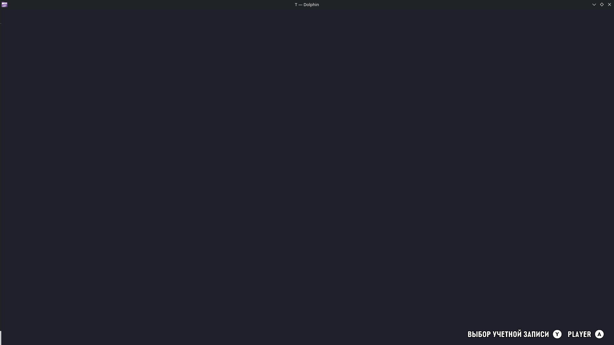
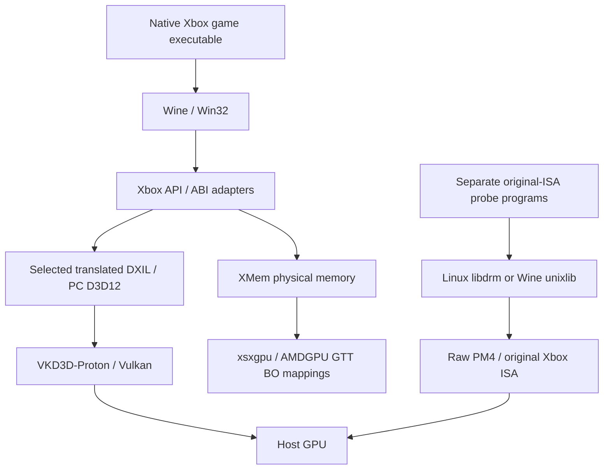

# XSX-Compat

Research into running native Xbox Series X x86-64 code on Linux, adapting Xbox API/ABI contracts around Wine, VKD3D-Proton and an experimental direct AMDGPU backend. The concrete game research target is GTA VI's `game_scarlett_master.exe`.

**November 26, 2026 checkpoint: partial account-selection UI is visible in the game, and separate probes execute original Xbox game shaders directly on the host RDNA2 GPU.** The game/UI path currently uses selected offline shader translations through PC D3D12 and VKD3D-Proton. The direct-ISA probes bypass that translation and each validate all 4,096 pixels; one also runs inside Wine. A complete menu, world rendering and gameplay remain unverified.



The screenshot is local visual evidence, not an exact-build GPU readback or proof of the complete game renderer.

Current game rendering uses the graphics fork of our **`d3d12_xs` adapter**, backed by PC D3D12 / VKD3D-Proton. It identifies Xbox programs by hash, loads selected translated `.dxil` programs and creates ordinary PC pipeline states. Missing programs can use diagnostic no-op fallback. Native AMDGPU BO-backed XMem is already active in game runs; this memory integration does not switch game draws to original ISA. See [the verified rendering paths](docs/RENDERING_PATHS.md).

The older null-audio run passed the **Game Running / Frame 82** stop and reached a 90-second timeout with at least 2,400 resource-backed PresentX calls. The newer screenshot shows account-selection text/buttons. Watchdog failures still appear in recent traces; neither the timeout nor the screenshot establishes complete rendering or stable gameplay.

This is a source distribution from a separate development workspace, with one explicitly reviewed screenshot. It supplies authored adapters, probes, parsers and build scripts. Original game/SDK/runtime files, shader payloads, generated translations, captures, logs, prefixes and binaries are supplied locally, not in this repository.

- [Current evidence and limitations](docs/STATUS.md)
- [Build prerequisites and commands](docs/BUILDING.md)
- [Verified game and direct-ISA rendering paths](docs/RENDERING_PATHS.md)
- [Direct graphics experiments and next steps](docs/NATIVE_GRAPHICS.md)
- [Publication selection and synchronization](docs/PUBLICATION.md)
- [Validation of this export](docs/VALIDATION.md)
- [External components](THIRD_PARTY.md)

## Current results

| Area | Recorded result | Scope |
|---|---|---|
| Visible UI | Account-selection label, `PLAYER`, button prompts | Supplied screenshot; complete menu/gameplay and exact-build association unverified |
| Native RDNA2 compute | 1,024/1,024 outputs, guards intact, fence complete | Handwritten compute ISA through raw PM4 |
| Original game VS + PS, standalone | 4,096/4,096 pixels, max error 0 | RECTLIST, linear RGBA8, selected blit pair on Navi21 |
| Original textured VS + PS, standalone | 4,096/4,096 pixels, max error 0 | Matrices through V#, synthetic linear T#, inline sampler; shifted-geometry control fails as expected |
| Wine unixlib | M1 open and M1b draw recorded PASS; 4,096/4,096 pixels | Direct AMDGPU execution inside a Wine process |
| UI translation/readback | 8 programs, 4 pairs, 8 cases, 512 pixels, exit 0 | Selected instruction translations through PC D3D12 |
| D3D12 adapter bridge using VKD3D | Historical 112 checks, 4 PSOs, 6 cases, 384 pixels, exit 0 | Earlier exact bridge build; later refresh/RECTLIST changes have a different test boundary |
| Game PSOs | 42 PC PSO creation records from selected game-program translations | Selected translated programs, not arbitrary native Xbox PSOs |
| Resource127 | Title 79/0, fallback 59/0, GPU readback and guards | Two 3840x2160 backbuffers fit the 64 MiB guest pool |
| Audio endpoint | 259 checks; WASAPI and spatial callbacks/buffers | Null PCM discards playback; game audio DSP/codecs remain incomplete |
| Game loop | 90-second timeout, exit 124, PresentX source counter at least 2,400 | No earlier audio writer assertion in that run; no normal game exit or correct image claim |
| Original Xbox FidelityFX | 27 resources, 5 heaps, SRV/UAV and root signature | Native PSO boundary remains: `0x8000000D`, harness exit 8 |
| HTTP libraries | Historical 139 checks, exit 0 | Plaintext numeric loopback with original local HC/XCurl libraries |

Results belong to the builds and inputs that produced them. Counters and diagnostic presentation do not establish a number of rendered game frames. See [STATUS.md](docs/STATUS.md) for proof boundaries and the later runtime observations.

## Architecture

Xbox Series CPU code already targets x86-64. The research concentrates on operating-system services, COM object layouts, return/argument ABI, shared memory, descriptors and GPU programs.




The lower direct-ISA path describes separate probe programs. Connecting the game's live command lists to this path is milestone M3. The XMem BO bridge is a memory integration already exercised by game runs.

## Three source paths

| Path | Role | Build |
|---|---|---|
| `compat/d3d12_xs/` | Main Xbox-to-PC D3D12 adapter, resource/heap ABI, frame clock, presentation and diagnostics | `bash compat/build-d3d12_xs.sh` |
| `local-agent-work/src/d3d12_xs/` | Fork of our D3D12 adapter using VKD3D: selected game PSOs, guest buffer snapshots, descriptor tracking and draw/presentation inspection | `bash local-agent-work/build-dll.sh` |
| `native-gfx/` | Direct AMDGPU Wine unixlib and BO-backed physical-memory experiment | `bash native-gfx/build.sh` |

The fork is intentionally a separate build. The ordinary game runner deploys the main DLL; `compat/run-native-ui-game.sh` deploys the fork after the normal dependencies. Direct ISA execution in `native-gfx` is distinct from the fork's `XSX_DEV_NATIVE_GFX` flag, which uses translated PC shaders.

## Runtime work since the Frame 82 checkpoint

- Texture Map/Unmap fallback, actual ResetX139 and deferred writes after real queue completion; the observed Map/Close failures were removed in their respective probes.
- Frame events78/79/80 honor the observed interval/token/timeout contract. Statistics81 returns count0/S_FALSE when unavailable, with the output records untouched.
- Resource127 returns real textures/buffers. XMem allocation attributes now control alignment, and guest backbuffer footprints are separate from native image allocation metadata.
- SurfaceBlit scales native resources into the window instead of requiring equal dimensions. Six GPU cases cover identity, up/down scaling, odd sizes, BGRA and 1x1.
- The writer stall was traced to an audio update path with zero output rings. A real null endpoint restored rings and repeated updates in the inspected run.
- GameInput now supplies a keyboard-driven virtual gamepad; the GameRuntime proxy includes an offline local XUser provider. These implementations do not establish gameplay or online account support.
- XCRDAPI source now includes a physical-destination path through `XsxPhysWrite` for uncompressed/zlib data. New game logs record successful physical-destination requests with the BO hook active; general correctness and dedicated runtime coverage remain unproven. BCpack, swizzle and physical sources remain unsupported.
- Physical section views now use individual 64 KiB pages to avoid transiently unmapping retained neighbors. A later opt-in XMem/AMDGPU BO hook is included as experimental source.

Native VKD3D resource vtables remain intact. The original working Xbox FFX resource/heap/layout adapters are retained; the old resource proxy remains diagnostic source.

## Shader work

The container tools validated 26,503 discovered shader containers / 26,698 variants. This is a record scan, not proof of complete enumeration of an encrypted archive TOC. FXCP/ACCC/FSPX/FSSM parsing, instruction provenance and selected HLSL/DXIL translation remain available.

The later native experiments execute original game ISA without HLSL translation. On Navi21/gfx1030, raw GFX PM4, hardware RECTLIST and selected PSO register values produced exact 64x64 readbacks for a color blit and a textured draw. Wrapped VS programs use a project-authored fetch subroutine. V# tables, low-address user SGPR tables and an explicit linear T# are controlled fixtures.

Shared/file-backed memory cannot use the demonstrated userptr path. The native branch instead explores GTT BOs mapped at matching CPU/GPU addresses, preserving aliases. The source now contains M2 helpers and an XMem hook; newer game logs show the native XMem BO hook active. A complete native game renderer and a dedicated passing M2 probe are not established in the inspected checkpoint. See [native graphics notes](docs/NATIVE_GRAPHICS.md).

## Source layout

```text
compat/
  d3d12_xs/           Main adapter and shared helpers
  runtime/            XMem, XCRDAPI, AcpHal, GameInput, runtime proxy
  sandbox/            Deployment, isolation and optional null audio
  tests/              ABI, resource, service and GPU probe source
    native-isa/       Linux raw-PM4 experiments and authored assembly
  tools/              Container, PE, translation and trace tools
  reports/            Two retained historical source checkpoints only
local-agent-work/
  src/d3d12_xs/       D3D12 adapter fork using VKD3D
native-gfx/
  src/                Wine PE/unix ABI, draw core, physical/GPU helpers
  EXPERIMENTS.md       Recorded direct-ISA experiment results
  build.sh
docs/                  Public status, build and evidence boundaries
tools/                 Source publication audit and workspace sync
```

## Building and checking

The public snapshot is not an installer. MinGW-w64 builds Windows adapters, native GCC/G++ builds portable tests, and Wine development tools plus libdrm build the unixlib. Original libraries, SDK headers and private shader fixtures are needed only for the workflows that name them.

```bash
python3 tools/audit-public-tree.py --verify-manifest
PYTHONDONTWRITEBYTECODE=1 python3 compat/tests/test-native-shader-pack.py RecordTests
PYTHONDONTWRITEBYTECODE=1 python3 compat/tests/test-xsx-shader.py ProvenanceTests
bash compat/build-d3d12_xs.sh
bash compat/build-xmem.sh
bash local-agent-work/build-dll.sh
bash native-gfx/build.sh
```

Build products are local and ignored. The publication audit intentionally rejects generated output even if Git ignores it: run it on the source selection before building, or in a clean source checkout. See [BUILDING.md](docs/BUILDING.md) for fixture requirements, output paths and runtime commands.

For an already prepared local game sandbox, the main diagnostic path is:

```bash
compat/sandbox/run-game.sh 90 XSX_SB_AUDIO=null XSX_DEV_NOOP_PSO=1 XSX_TRACE_RETURNS=1
```

The selected-program fork additionally requires its private generated cache and probe fixtures:

```bash
bash local-agent-work/build-dll.sh
bash compat/build-native-ui-bridge-probe.sh
bash compat/run-native-ui-bridge-probe.sh
bash compat/run-native-ui-game.sh 90
```

The bridge probe sets `XSX_DEV_GFX_REFRESH=0` because it tests draw-time snapshots by mutating guest memory before submit. The game defaults to submit-time refresh. The earlier 112/0 result does not validate that later refresh policy or general Xbox memory coherence.

## Next milestones

1. Validate the native Wine/sandbox and BO-backed physical-memory paths against the exact current source.
2. Connect live Xbox command recording and resource tables to original ISA execution, including native compute.
3. Establish real texture layouts, cache synchronization and CPU/GPU visibility; add presentation interoperability.
4. Resolve recurring watchdog failures, resource-data assertions and incomplete game rendering.
5. Advance beyond the first visible account-selection UI to a complete menu, correct game frame, input and longer execution. Extend audio DSP/codecs and services separately.

## Publication and provenance

`git_repo` is a separate source export, not the development root. The synchronization tool compares selected authored sources and preserves reviewed export adjustments:

```bash
python3 tools/sync-from-workspace.py --workspace ..
python3 tools/sync-from-workspace.py --workspace .. --apply
python3 tools/audit-public-tree.py --verify-manifest
```

The default sync command is read-only. It does not commit, change remotes or publish. Public manifests record relative paths and SHA-256 hashes; original game inputs and raw evidence remain outside the export. See [PUBLICATION.md](docs/PUBLICATION.md).

The project-wide license remains unspecified. External notices and implementation references, including miniz and VIctory, are retained in [THIRD_PARTY.md](THIRD_PARTY.md).
